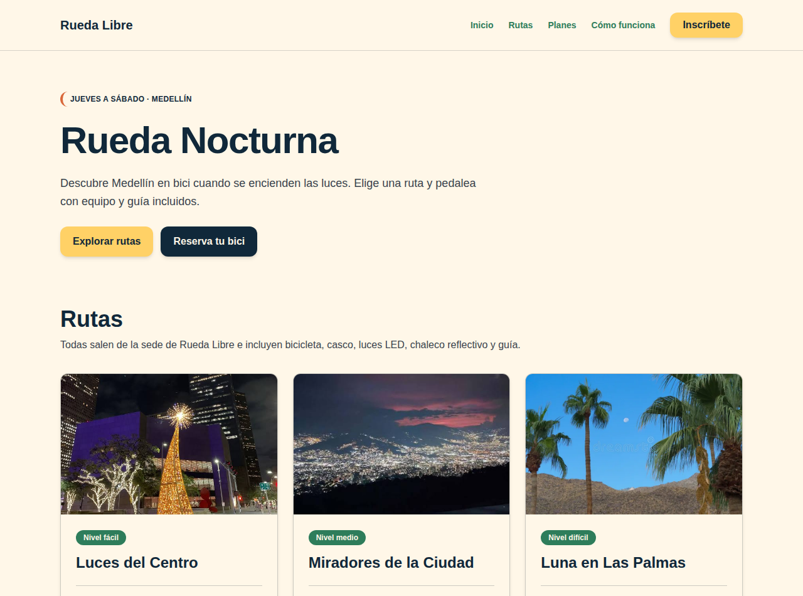
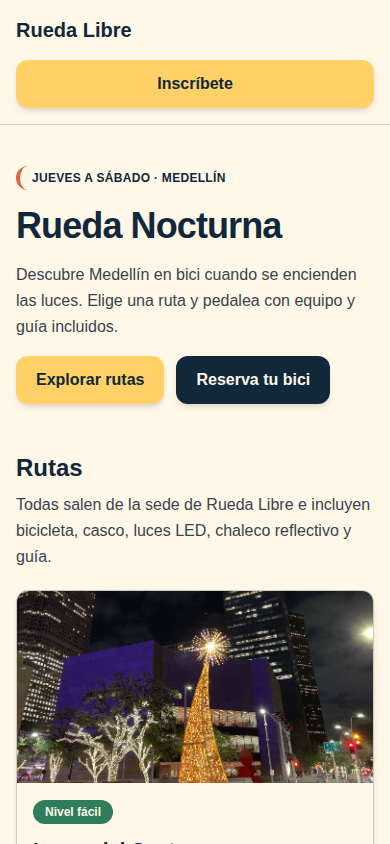
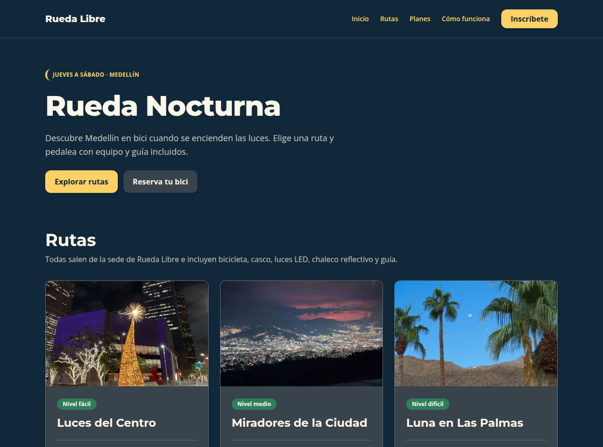

# Rueda Libre

Sitio de alquiler de bicicletas y promoción de rutas guiadas en Medellín. El proyecto combina el sitio principal desarrollado con Bootstrap y la campaña **Rueda Nocturna** desarrollada con Tailwind CSS.

## Sitio publicado

- [Inicio](https://wiliend69.github.io/trayecto1/)
- [Tarifas](https://wiliend69.github.io/trayecto1/paginas/tarifa.html)
- [Reservas](https://wiliend69.github.io/trayecto1/paginas/reservas.html)
- [Flota y rutas](https://wiliend69.github.io/trayecto1/prueba/catalogo-bootstrap.html)
- [Landing Rueda Nocturna](https://wiliend69.github.io/trayecto1/nocturna/)
- [Kit de componentes](https://wiliend69.github.io/trayecto1/nocturna/componentes.html)

## Páginas

El sitio Bootstrap contiene Inicio, Tarifas, Reservas y Flota y rutas. La campaña Tailwind contiene la landing de Rueda Nocturna y una galería de componentes. La navegación conecta ambos productos y sus llamadas a la acción llevan a las reservas.

## Tecnologías

- HTML semántico y accesibilidad con etiquetas asociadas, textos alternativos y navegación por teclado.
- Bootstrap para el sitio v2.0 y sus componentes convencionales (CSS 5.3.x; Inicio conserva un bundle JS 6.0 alpha y Reservas usa 5.3.3).
- Tailwind CSS 4.3.5 CLI para la campaña, con `@theme`, variantes responsive y `dark:` según `prefers-color-scheme`.
- Montserrat para títulos y Open Sans para texto, servidas por Google Fonts.
- Tema de marca compartido: Verde Ruta `#2e7d5b`, Azul Noche `#10283a`, Naranja Pedal `#d9683a`, Gris Asfalto `#39434c`, Crema `#fff7e8` y Amarillo Farol `#ffd166`.

Desde la raíz del proyecto, los comandos de Tailwind son:

```bash
npm --prefix nocturna run build
npm --prefix nocturna run dev
```

El build genera `nocturna/src/output.css` minificado; el artefacto se versiona para que GitHub Pages no dependa de ejecutar la CLI.

## Recomendación de framework

Para la próxima versión de Rueda Libre recomiendo **Tailwind CSS**, migrando por páginas y sin cargar ambos frameworks en cada documento. En esta campaña los tokens de marca, el responsive, el modo oscuro y los componentes de botón quedaron en un CSS minificado de **28,146 B**.

| Criterio | Bootstrap v2.0 | Tailwind Rueda Nocturna |
| --- | --- | --- |
| Curva de aprendizaje | Inicio rápido con componentes y convenciones preparadas. | Hay que aprender y leer utilidades; las clases se pueden extraer con moderación cuando se repiten. |
| Personalización | Los ajustes actuales mezclan utilidades e inline styles; normalizar una marca en varias páginas cuesta mantener. | `@theme` centraliza colores y fuentes, y las variantes `dark:` y responsive se componen directamente en las clases. |
| Tamaño final medido | Bootstrap CSS: 232,111 B; bundle JS: 219,860 B; 94,201 B de payload Brotli combinado. | CSS Tailwind minificado de la campaña: 28,146 B; sin JavaScript de framework para esta landing estática. |
| Casos de uso | Prototipos veloces y páginas que requieren componentes Bootstrap listos. | Experiencias de marca con diseño responsive, modo oscuro y control del CSS enviado. |

La medición de Bootstrap corresponde a `index.html` v2.0: CSS 5.3.8 y bundle JS 6.0.0-alpha.1. El navegador confirmó ambas solicitudes; como jsDelivr no expone `Timing-Allow-Origin`, los bytes transferidos se midieron descargando esas mismas URLs. Son bytes del payload comprimido, sin headers; el CSS de Tailwind no incluye las descargas separadas de Google Fonts.

## Capturas

**Escritorio**



**Celular**



**Modo oscuro**



## Verificación y aprendizajes

- W3C Nu Validator: landing y Reservas sin errores ni avisos.
- Checklist global: siete documentos HTML sin atributos `style=`, imágenes con `alt` y rutas locales existentes.
- Responsive: Inicio, Tarifas, Reservas, Flota, landing y componentes comprobados a 360, 768 y 1280 px; sin desbordamiento horizontal y con imágenes cargadas.
- Accesibilidad: cabeceras semánticas, labels asociados y recorrido por teclado en navegación y formularios. Los formularios se probaron vacíos y completos.
- Modo claro/oscuro: emulado en la landing; el contraste de texto evita Verde Ruta sobre Azul Noche (3.03:1). Azul Noche sobre Amarillo Farol alcanza 10.50:1.
- Conviene compartir tokens y rutas entre los productos, pero mantener aisladas sus hojas de framework. En Tailwind, extraer solo patrones repetidos evita que el HTML se vuelva difícil de leer.

## Autor

**wiliend69**